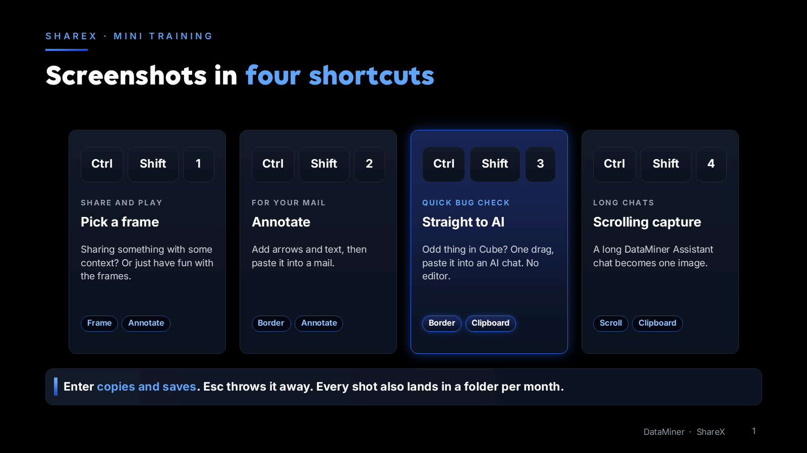
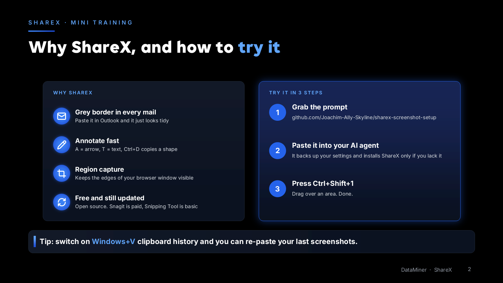
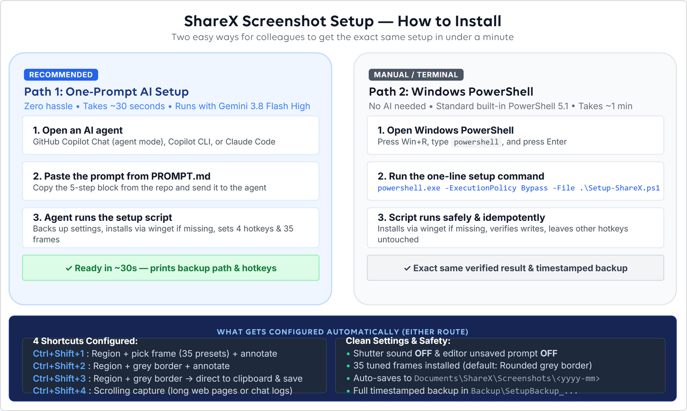
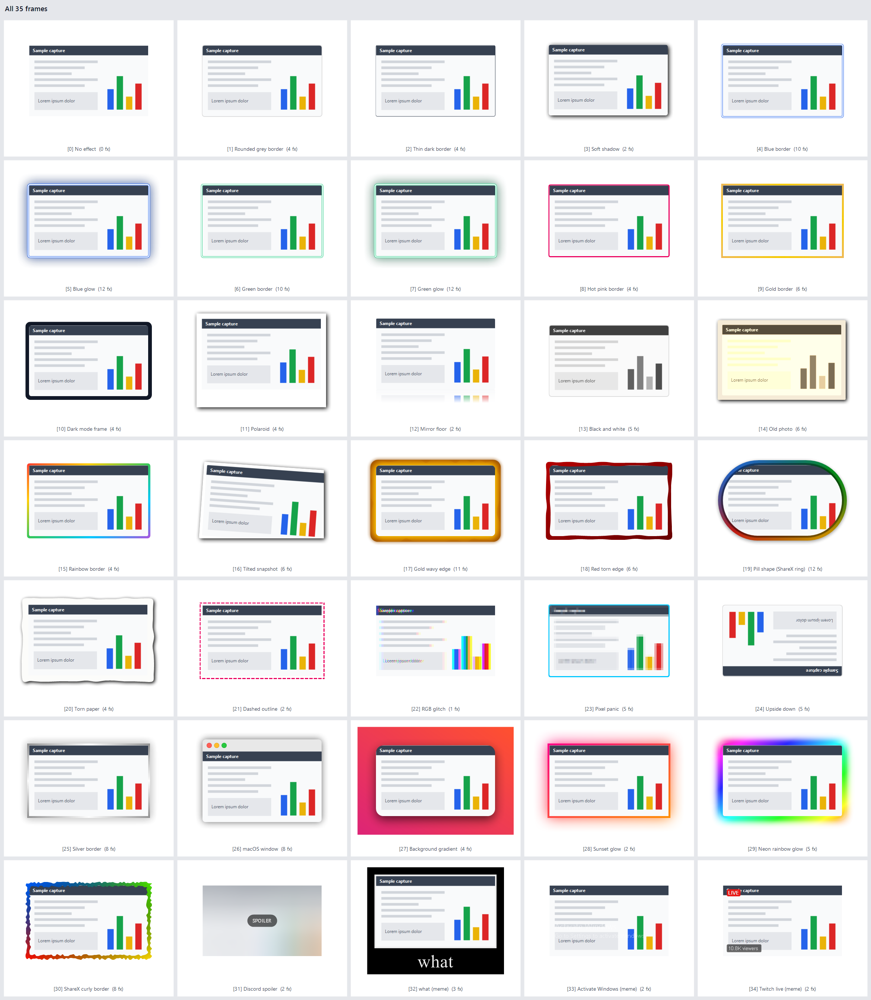

# ShareX Screenshot Setup

A ready-to-use [ShareX](https://getsharex.com) configuration tailored for clean, professional screenshots in DataMiner, customer emails, Teams, and documentation.

The best part: **you can apply the entire setup in under a minute with a single AI prompt or one PowerShell command.** No accounts, no manual clicking through settings.





> **Presentation slides:** [ShareX mini training.pptx](ShareX%20mini%20training.pptx)

---

## ⚡ Try It Yourself

Pick whichever installation method fits your workflow:



### Option A: With an AI agent (1 prompt)

Open [**PROMPT.md**](PROMPT.md), copy the prompt, and paste it into any AI agent that can run PowerShell commands on your PC (such as **GitHub Copilot CLI**, **Copilot Chat in agent mode**, or Claude Code):

```text
Set up ShareX on this Windows PC using the script in this public repo:
https://github.com/Joachim-Ally-Skyline/sharex-screenshot-setup
```

The agent downloads the script, summarizes what it will do, runs it safely, and reports the configured hotkeys and backup path.

### Option B: Run in Windows PowerShell (1 command)

Open Windows PowerShell (Run as regular user, no admin required) and run:

```powershell
# Run directly without cloning:
irm https://raw.githubusercontent.com/Joachim-Ally-Skyline/sharex-screenshot-setup/main/Setup-ShareX.ps1 -OutFile $env:TEMP\Setup-ShareX.ps1; powershell.exe -NoProfile -ExecutionPolicy Bypass -File $env:TEMP\Setup-ShareX.ps1
```

*(If you already cloned this repository locally, run: `powershell.exe -NoProfile -ExecutionPolicy Bypass -File .\Setup-ShareX.ps1`)*

### 🛡️ Safety & Idempotency

- **Automatic backup:** Backs up your existing ShareX configuration to `Documents\ShareX\Backup\SetupBackup_<timestamp>` before making changes.
- **Smart install:** Only installs ShareX (via `winget`) if it is not already installed.
- **Surgical edits:** Only configures the four hotkeys, frame effects, and annotation styling listed below. Other custom hotkeys or uploaders remain untouched.
- **Safe to rerun:** Run it as many times as you like; nothing breaks.

---

## 🎯 The Four Shortcuts

| Shortcut | What happens | Best for |
|---|---|---|
| **Ctrl + Shift + 1** | Drag an area → **pick a frame** (35 presets) → annotate → Enter | Sharing screenshots with context or custom styling |
| **Ctrl + Shift + 2** | Drag an area → **rounded grey border** → annotate (arrows/text) → Enter | Quick, polished screenshots for customer emails & tickets |
| **Ctrl + Shift + 3** | Drag an area → rounded grey border → **straight to clipboard** | Instant captures to feed into an AI or quick chat message |
| **Ctrl + Shift + 4** | **Scrolling capture**: select a window → one long seamless image | Long DataMiner Assistant conversations, Cube tables, or web pages |

### 🎬 Explainer Videos (30 seconds each)

Short walkthrough videos are available in the [`videos/`](videos/) folder:
- [**DataMiner Assistant conversation (Ctrl+Shift+4)**](videos/ShareX%20-%20Ctrl+Shift+4%20DataMiner%20Assistant%20conversation.mp4): Captures a long AI conversation spanning multiple screens into one crisp image.


https://github.com/user-attachments/assets/ec604016-643f-4fc1-a2f9-cbd27a033490

- [**Quick customer screenshot with arrows (Ctrl+Shift+2)**](videos/ShareX%20-%20Ctrl+Shift+2%20quick%20screenshot%20for%20a%20customer.mp4): Capture, draw an arrow, add a note, press Enter, paste into Outlook.


https://github.com/user-attachments/assets/c8935811-1825-4c4c-8e12-28124dd0419b

- [**Install in one prompt**](videos/ShareX%20-%20install%20in%20one%20prompt.mp4): Watch an agent run the setup script end-to-end.

https://github.com/user-attachments/assets/bfdf23c8-f08b-4032-968b-d5381f144218

---

## ✨ Unified Team Styling & Zero Annoyance

Every shortcut comes with tuned defaults designed to look clean and avoid friction:

- **Consistent styling:** Pink-red arrows and boxes (`#E8395B`) with rounded corners, thin text, blur 11, and pixelate 7.
- **No annoying interruptions:** Capture sound is disabled, and the "unsaved changes" dialog when exiting the editor is turned off.
- **Never lose a screenshot:** Every capture finished with Enter is copied to the clipboard and automatically archived in `Documents\ShareX\Screenshots\<yyyy-mm>\`.
- **Background startup:** ShareX starts with Windows automatically, minimized quietly in the system tray.

---

## 🎨 35 Frame Presets

**Ctrl + Shift + 1** opens the frame selector after capture with 35 presets, ranging from subtle professional frames to playful borders:

- **Professional:** Rounded grey border (default), Thin dark border, Soft shadow, Dark mode frame, Blue/Green glow.
- **Creative & playful:** Polaroid, Torn paper edge, Gold wavy edge, Mirror floor, RGB glitch, What (meme), and Upside down.



---

## ⌨️ Editor Cheatsheet

When the ShareX annotation editor opens:

| Key | Tool |
|---|---|
| `A` | Arrow |
| `T` | Text box |
| `R` | Rectangle |
| `O` | Ellipse / Oval |
| `B` | Blur / Pixelate tool |
| `Ctrl + D` | Duplicate selected element |
| `Enter` | Copy to clipboard, save file, and close editor |
| `Esc` | Discard / close without popup |

> **Pro-Tip:** Turn on **Windows Clipboard History** (`Win + V`). Take multiple captures in a row, then paste whichever you need into your mail or ticket.

---

## 💡 Why ShareX

[ShareX](https://getsharex.com) is free, open source, and actively maintained. The subtle grey rounded border looks crisp and professional in Outlook and Teams, and region capture keeps the edges of your browser or app window visible. It replaces clunky paid tools like Snagit while offering far more power than the basic Snipping Tool.

Bonus built-in features:
- **OCR text recognition:** Tray icon → Capture → Text recognition (OCR).
- **Screen recordings & GIFs:** `Shift + PrintScreen` for MP4 video, `Ctrl + Shift + PrintScreen` for animated GIF.

---

## 🔄 How to Undo

If you ever want to revert to your previous setup:

1. Right-click the ShareX tray icon and select **Exit**.
2. Go to `Documents\ShareX\Backup\SetupBackup_<timestamp>\`.
3. Copy the backup files back into `Documents\ShareX\`.
4. Start ShareX again.

---

## 📋 Requirements

- Windows 10 or 11
- Windows PowerShell 5.1 (built into Windows)
- `winget` (only required if ShareX is not already installed)
- Tested with ShareX 21

