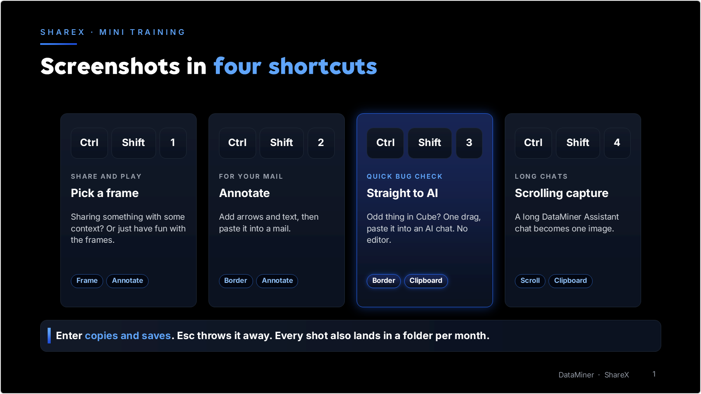
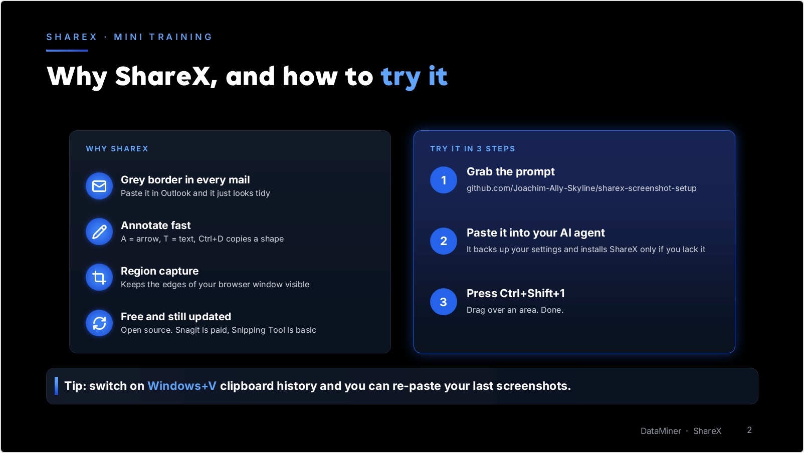
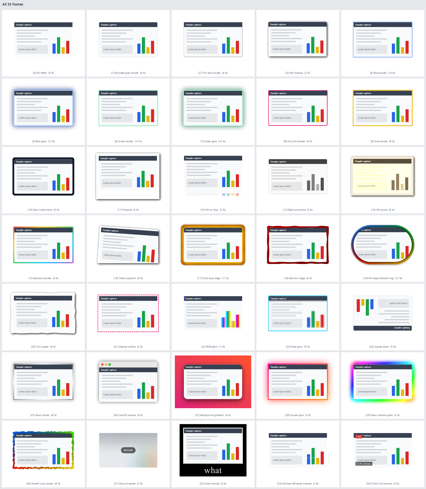

# ShareX screenshot setup

This is the material for a 5-minute demo about taking screenshots with [ShareX](https://getsharex.com). The nice part: if you like how it works, you can copy every setting in one go with a single prompt. No account needed.





The slides as a PowerPoint: [ShareX mini training.pptx](<ShareX mini training.pptx>)

## Try it yourself

Open [PROMPT.md](PROMPT.md), paste the prompt into an AI agent that can run PowerShell, and let it work. Prefer to do it by hand? Run this in Windows PowerShell:

```powershell
powershell.exe -NoProfile -ExecutionPolicy Bypass -File .\Setup-ShareX.ps1
```

Before it changes anything, the script backs up your current ShareX settings (`Backup\SetupBackup_<timestamp>` in your ShareX folder). It installs ShareX with `winget` only when you don't have it yet, and it starts ShareX with Windows, tray only. Only the settings listed below are touched, everything else stays as it was. Run it twice and nothing breaks.

## The four shortcuts

| Shortcut | What happens | Handy for |
|---|---|---|
| Ctrl+Shift+1 | Drag an area, pick a frame, annotate, Enter | Sharing something with context, or playing with the frames |
| Ctrl+Shift+2 | Drag an area, get the grey rounded border, annotate, Enter | A screenshot with arrows for a mail |
| Ctrl+Shift+3 | Drag an area, border, straight to the clipboard | A quick bug in Cube that you want an AI to look at |
| Ctrl+Shift+4 | Scrolling capture: pick a window, get one long image | A long DataMiner Assistant chat or web page |

A few things apply to all of them:

- No capture sound, and no "unsaved changes" question when you close the editor.
- Annotations look the same for everyone: pink-red arrows and rectangles with rounded corners, thin text, blur 11, pixelate 7.
- Every screenshot lands on the clipboard and in `Documents\ShareX\Screenshots\<year-month>`.
- There are 35 frames in Ctrl+Shift+1, ordered from neutral to a bit silly. The default is Rounded grey border. Further down you get a thin dark border, glows, a Polaroid, a torn paper edge, RGB glitch, what (meme) and even Upside down.



## In the editor

`A` is an arrow, `T` is text, `R` is a rectangle, `Ctrl+D` duplicates the selected shape. `Enter` copies and saves. The editor also copies the image to your clipboard by itself while you work, so a screenshot is never lost, even if you close the editor with `Esc`.

One more trick: switch on Windows clipboard history with Windows+V. Take a few screenshots, then paste the one you need.

## Why ShareX

[ShareX](https://getsharex.com) is free, open source and still updated. The grey border looks tidy in a mail, and region capture keeps the edges of your browser window visible. Snagit costs money and the Snipping Tool is fairly basic.

There's more in there that the demo skips: OCR (tray icon, under Capture), Blur and Pixelate in the editor, Shift+PrintScreen for a screen recording and Ctrl+Shift+PrintScreen for a GIF.

## Undo

Close ShareX (tray, Exit), copy the files from `Backup\SetupBackup_<timestamp>` back into the ShareX folder (`Documents\ShareX`), and start ShareX again.

## Requirements

Windows 10 or 11 with Windows PowerShell 5.1, which is built in. `winget` is only needed if ShareX isn't installed yet. Tested with ShareX 21.
